<p align="center">
  
</p>

<p align="center">
  <a href="https://github.com/tasin-py/AstralEngine/releases/latest"></a>
  
  
  <a href="https://www.supportkori.com/tasinpy"></a>
</p>

<p align="center">
  <b>Your Wallpaper Engine library, lighter.</b><br>
  Scenes, videos and web wallpapers from the Steam Workshop, plus widgets and Rainmeter,<br>
  in a dark, familiar app that gets out of the way when you're working.
</p>

<br>

<p align="center">
  
</p>

## ⚡ Lighter than Wallpaper Engine

<p align="center">
  
</p>

Both apps were measured with the same script on the same PC with the same Workshop video. The headline numbers are for the whole app while a maximized window pauses the wallpaper. Wallpaper Engine keeps its library UI running in the background (6 processes, about 640 MB); Astral frees its window when you close it.

<details>
<summary><b>Full numbers and method</b></summary>

| Scenario | Wallpaper Engine | Astral Engine |
|---|---:|---:|
| Paused, everything running in the background | 808 MB RAM · 3.86 % CPU | **156 MB RAM · 0.14 % CPU** |
| Paused, wallpaper processes only | 169 MB RAM · 0.08 % CPU | **156 MB RAM · 0.14 % CPU** |
| Video playing, library closed | *not measured yet* | 372 MB RAM · 2.56 % CPU |
| Scene playing, library closed | – | 427 MB RAM · 1.74 % CPU |

Measured with `scripts/bench-processes.ps1`. Raw data and per-process detail are in [`benchmarks/`](benchmarks/RESULTS.md).

To be fair about it: while a wallpaper is *playing*, Wallpaper Engine's native D3D11 renderer still uses less RAM than Astral's Chromium-based one. Astral wins by unloading everything it isn't using.

</details>

## ✨ All features

<details open>
<summary><b>Everything Astral can do</b></summary>

**Wallpapers**
- **Steam Workshop:** finds your Steam libraries and subscribed Wallpaper Engine items automatically. Browse, search and filter the Workshop with no account or API key. Subscribe opens the wallpaper's page in your Steam app (or your web browser, if you prefer), so Astral never asks for your Steam login; it appears in Installed as soon as Steam downloads it (Wallpaper Engine must be owned on that Steam account).
- **Scene wallpapers:** native renderer for Wallpaper Engine `scene.pkg` files covering images, effects/shaders, particles, text, sounds, parallax, camera shake, SceneScript and audio response.
- **Video wallpapers:** MP4/WebM/HEVC with hardware decoding, looping, volume and playback rate.
- **Web wallpapers:** HTML wallpapers with the Wallpaper Engine web API (user properties, audio listener).
- **Images**, plus drag-and-drop import of your own files and folders.
- **Multi-monitor:** a different wallpaper per display, or one stretched/cloned across all of them. Works with mixed scaling (e.g. 100% + 125%); an "Apply to" picker chooses one display or all of them.
- **Playlists:** timer, time-of-day or once-per-login rotation, in order or shuffled.

**Customisation**
- Each wallpaper's own properties (colours, sliders, toggles, combos), with conditions.
- **Built-in display properties for every wallpaper:** volume, playback rate, alignment (cover/fit/stretch), flip, image filter, and colour options (brightness, contrast, saturation, hue).
- **Presets:** save, load, apply to all wallpapers, share as JSON, paste JSON, reset.
- **Desktop widgets:** clock, analog clock (8 faces), calendar, system monitor, weather, sticky notes (colours, + for a new note), audio visualiser (9 styles: bars, mirrored, wave, filled wave, circle, ring, dots, LED blocks, lines; gradient or rainbow colours), battery, countdown, photo frame and quotes. Any installed Windows font or one of 15 bundled fonts, border on/off, optional × button, one switch to turn all widgets on or off. Draggable and lockable, with click-through.
- **Rainmeter:** on/off switch, list, activate and deactivate skins, load layouts, refresh, edit, drag and drop `.rmskin` packages to install them, and find new skins on DeviantArt or VisualSkins.
- **Taskbar styling:** transparent, blur, acrylic or tinted.

**Performance**
- Pauses, mutes or fully stops wallpapers when another app is focused, maximized or fullscreen, on battery, or when the PC is locked. Each monitor is handled separately.
- FPS limit and render-quality scaling.
- **Feature switches** (Settings › Features): turn off Widgets, Rainmeter, Workshop browsing, Playlists, Taskbar styling or the audio visualiser. A feature that's off is fully unloaded, so it uses no memory, CPU or network.
- Closing the library window frees its memory; wallpapers keep running from the tray.
- Idle memory goes back to Windows while everything is paused.

**App**
- Remembers everything between launches: settings, wallpapers, pause state, window size, library sort and filters.
- **Check for updates** button (Settings › Updates, About, or the tray menu), using GitHub Releases.
- **Buy Me a Coffee** button in Settings › About & Support and in the tray menu.
- Dark installer with a choice of install folder, plus a portable build.

</details>

## 🆚 Astral vs Wallpaper Engine: what each can do

| Feature | Wallpaper Engine | Astral |
|---|:---:|:---:|
| Steam Workshop wallpapers (scene / video / web) | ✅ | ✅ |
| Workshop browsing, subscribing | ✅ | ✅ (subscribe via the Steam app) |
| Video wallpapers, hardware decoding | ✅ | ✅ |
| Scene effects & particles | ✅ | ✅ (most shaders; a few community effects are skipped) |
| SceneScript | ✅ | ✅ (common API) |
| 3D scenes (3D models), puppet-warp animation | ✅ | ❌ (3D scenes are detected and marked "not supported yet") |
| Application (.exe) wallpapers | ✅ | ❌ (blocked for safety) |
| Built-in props: volume, rate, alignment, flip, filter, colours | ✅ | ✅ |
| Presets (save / load / apply to all / share JSON) | ✅ | ✅ |
| Playlists | ✅ | ✅ |
| Pause/stop rules, per-monitor | ✅ | ✅ |
| Multi-monitor, span, clone | ✅ | ✅ |
| Wallpaper editor | ✅ | ❌ |
| Desktop widgets | ❌ (separate add-ons) | ✅ 11 built in |
| Rainmeter skin manager | ❌ | ✅ |
| Taskbar styling | ❌ | ✅ |
| Feature switches to unload extras | ❌ | ✅ |
| Library UI fully freed when closed | ❌ | ✅ |
| Free & open source | ❌ | ✅ |

Astral reads Wallpaper Engine files **read-only**. It never modifies the Wallpaper Engine installation or your Workshop downloads.

## 📥 Install

Download from the [Releases page](https://github.com/tasin-py/AstralEngine/releases/latest):
- **`AstralEngine-Setup-x.y.z.exe`**: installer. You can choose a folder and install for just you or for everyone; it adds Start-menu and desktop shortcuts and an uninstaller.
- **`AstralEngine-Portable-x.y.z.exe`**: runs without installing.

Requirements: Windows 10/11 (64-bit). For Workshop content: Steam with Wallpaper Engine owned and the items subscribed.

## 🛠️ Build from source

```bash
git clone https://github.com/tasin-py/AstralEngine.git
cd AstralEngine
npm install
npm start               # run in development
npm test                # unit tests
npm run selftest        # end-to-end check: UI, every wallpaper type, pause, widgets, resources
npm run dist            # installer + portable exe in dist/
```

Other scripts: `npm run dist:art` redraws the installer artwork. `npm run bench:we`, `npm run bench:astral` and `npm run bench:report` handle benchmarks. `npx electron test/shadercheck/main.js` compiles every scene shader found on this PC.

### Updates

"Check for updates" reads the latest release of [tasin-py/AstralEngine](https://github.com/tasin-py/AstralEngine/releases) (set in `src/main/config.js` as `UPDATE_REPO`; users can override it in Settings › Updates).

To ship an update:
1. Raise `version` in `package.json` (for example `1.0.1`) and run `npm run dist`.
2. Create a GitHub release tagged `v1.0.1` and attach `dist/AstralEngine-Setup-1.0.1.exe` (and the portable exe if you like).
3. Installed copies see the update on their next check, then download and run the installer for the user.

## 🔭 How it works

See [docs/HOW_WALLPAPER_ENGINE_WORKS.md](docs/HOW_WALLPAPER_ENGINE_WORKS.md) for how desktop embedding, the scene format, textures, shaders and Workshop access work, and how Astral implements each.

## ☕ Support

Astral is free and always will be. If it made your desktop nicer, a coffee keeps the stars spinning.

<p align="center">
  <a href="https://www.supportkori.com/tasinpy"></a>
</p>

## 📄 License

Third-party components and their licences are listed in [THIRD_PARTY_NOTICES.txt](THIRD_PARTY_NOTICES.txt).


MIT. Wallpaper Engine is a product of its respective owners. Astral is an independent project and isn't affiliated with Wallpaper Engine or Valve. Workshop content belongs to its authors.
